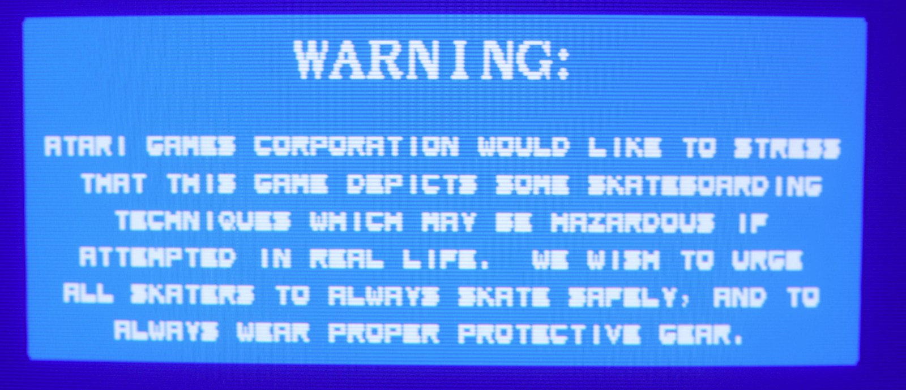
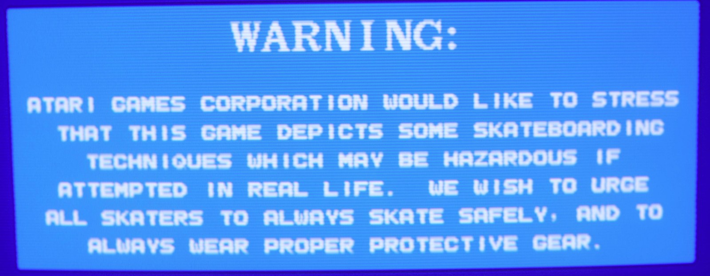
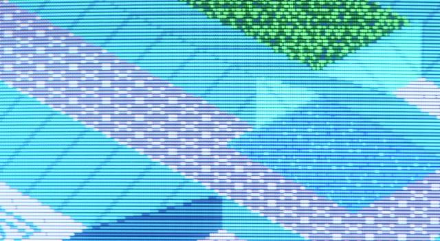
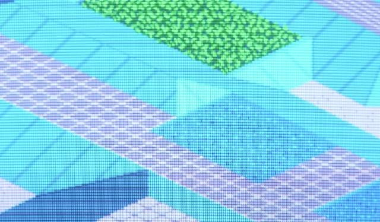

# crt_480i: medium-res MiSTer cores on a 15 kHz CRT

A module for MiSTer cores. It turns a medium-res (about 25 kHz) progressive picture, such
as 512x384 at 60 Hz, into **interlaced 15 kHz** video on the analog (VGA) output: 525-line
**480i** for a 60 Hz source, 625-line 576i for 50 Hz, and an odd line count in between for
any other frame rate, so the line rate stays near 15.7 kHz. That lets
a normal low-res CRT, PVM or 15 kHz arcade monitor show it with every source line intact,
while HDMI shows the normal picture.

| The usual 240-line output | CRT 480i |
|---|---|
|  |  |
|  |  |

*720 Degrees, photographed on a 15 kHz CRT. At 240 lines the 384-line picture loses rows: the
letters of the warning screen are uneven and the fine lines of the skate park break into
dashes. In 480i every line is drawn.*

Copyright (c) 2026 Chris Watson. Licence: GPL-2.0-or-later (see `LICENSE`).

## What a crt_480i build is

A separate core, released next to the stock one, for 15 kHz monitors:

- **VGA / analog (and JAMMA): 15 kHz 480i only.** The module has no path from its input to
  its output. Until it has locked onto the game (core load, reset, a timing change) the
  output is black with both syncs idle. No menu option or `MiSTer.ini` setting can put the
  native 25 kHz picture, or the scaler, on the analog output. Some 15 kHz monitors are
  damaged by 24-25 kHz, so there is deliberately no way to switch to medium res.
- **HDMI: the normal picture.** The core's native progressive picture goes to the HDMI
  scaler as usual, with its Aspect ratio, Scale and Orientation options.
- **direct_video** (HDMI into a VGA DAC) carries the 480i stream, like VGA.

Multi-sync and 31 kHz VGA monitor users keep using the stock core.

Tested on: Sony PVM, Panasonic CRT TV, Wells-Gardner and Hantarex arcade monitors.

**Disclaimer.** Every effort has been made to make this safe for 15 kHz monitors: the analog
output has no path for the 25 kHz picture, the source is open for anyone to check, and it
has been tested on several 15 kHz monitors. Even so, it is provided as is, without warranty
of any kind, and you use it at your own risk: the authors can't be held responsible for
damage to your monitor or other equipment.

## Credits

- **rmonic79**: the approach (measure the source, buffer lines in a ring, lock once
  stable) was inspired by `crt_vsize.sv` in
  [MiSTer-CRT-Adjust](https://github.com/rmonic79/MiSTer-CRT-Adjust). `crt_480i` is an
  independent implementation.
- **RetroShrimp** (Atari System 2, Toobin') and **Fulviuus** (Hard Drivin', github.com/retrogarage): the MiSTer
  cores the example patches apply to.
- **MiSTer-devel / Sorgelig**: the MiSTer framework (`sys_top`, `arcade_video`) that the
  `sys` patch modifies.

```
rtl/crt_480i.sv      the module: one SystemVerilog file, Quartus 17 friendly
sim/                 self-checking testbench, run.sh (one run), sweep.sh (62 runs)
examples/            sys.patch (the framework change) and three complete cores
AGENTS.md            instructions for an AI coding agent doing the port
skill/crt-480i/      the same, as an agent skill (built from AGENTS.md by make-skill.sh)
```

## How it works

- **One output field per source frame.** Field 0 carries source lines 0,2,4..., field 1
  lines 1,3,5... Every field comes from a new frame, so motion stays at the source's 60 Hz.
  Only the fine vertical detail is split across two fields.
- **Real interlace.** An odd number of half-lines a frame (525 at 60 Hz: 262.5 lines per
  field); field 1's VSync starts half a line late, so the CRT draws its lines between field
  0's. `field` drives `VGA_F1`.
- **Line count from the frame rate.** The output line rate is (half-lines / 2) x the source
  frame rate, so a fixed 525 would give 14.4 kHz at 54.8 Hz and 13.1 kHz at 50 Hz, which a 15
  kHz CRT cannot hold. The module measures the frame and picks the odd count nearest a line
  rate of 15075 + 11 x frame rate (Hz): 525 at 59.94 Hz, 625 at 50 Hz, 571 at 54.8 Hz, 547 at
  57.5 Hz, all 15.6-15.8 kHz. Never fewer than 525: from 59.94 Hz up a field keeps 262.5 lines
  and the line rate rises with the frame rate (16.5 kHz at 62.86 Hz). The extra lines of a
  slower frame are split above and below the picture, so it stays centred. The count is
  held while locked.
- **Phase-locked.** Each field starts a measured delay after the source VSync: no drift, no
  dropped or repeated frames. Latency is under one frame.
- **Self-measuring.** Frame period, line period, active size and VSync-to-picture time are
  measured, not configured. It locks once 3 frames in a row have matched periods (within
  4 clocks), about 5 frames after the core starts, and only from 49 Hz up to the rate where
  525 half-lines give a 16.5 kHz line (62.86 Hz; lower if `H_START + W_MAX` pixels would not
  fit that line, which the build's clock settles). So the output line is always 15.6-16.5
  kHz. If the
  source VSync stops it drops the lock within a frame. A source whose frame period jitters
  by more than 4 clocks (for example regenerated through a clock crossing) never locks.
- **Storage.** A ring of 96 source lines holds pixel values, ideally palette indexes looked
  up through the core's own palette, to keep block RAM down: 96 x 512 x PW bits.
- **Height.** 1:1 (half the source lines per field, bordered) or stretched to 200-240
  lines per field. Narrower or shorter pictures are centred.
- **Deflicker.** Off / Mild (1-6-1) / Medium (3-10-3) / Medium+ (13-38-13) / Full (1-2-1).
  When the picture is stretched, lines are deflickered first and then interpolated, so a
  level behaves the same at every height.

## Parameters

| Parameter | Default | Meaning |
|---|---|---|
| `CLK_HZ` | (required) | the module clock in Hz, accurately: it sets the lock window (49 Hz to at most 62.86 Hz) and the line count, so a wrong value can admit a faster source or a wrong line rate. |
| `CLK_DIV` | 3 | output pixel = `clk / CLK_DIV`. Aim for about 10-11 MHz (e.g. 32/3, 64/6). Minimum 3. See *Other video clocks*. |
| `CLK_FRAC` | 0 | 1: pixels alternate `CLK_DIV` and `CLK_DIV+1` clocks, averaging `CLK_DIV+0.5` (48 MHz with `CLK_DIV(4)` gives exactly 10.67 MHz). Needs `(4+LUT_LAT)/CLK_DIV == (4+LUT_LAT)/(CLK_DIV+1)`, e.g. `CLK_DIV 4`. |
| `PW` | 8 | bits stored per pixel (a palette index, or packed colour) |
| `LUT_EXT` | 1 | 1: colours come from the core via `lut_addr` -> `lut_rgb`; 0: `pix_in` is packed RGB |
| `LUT_LAT` | 1 | clocks from `lut_addr` to `lut_rgb`, 1 or 2 (`LUT_EXT=1` only). Use 2, and register your palette output, if the palette logic is heavy. |
| `W_MAX` / `RING` | 512 / 96 | stored width (a power of 2) and number of stored lines. Pixels past `W_MAX` are dropped. |
| `H_START`, `HS_PIX`, `VIS_FIRST`, `VIS_LINES`, `VS_HL`, `VS_LEN` | | output timing; the defaults are standard 480i |

The build stops with a named error (a missing module called, for example,
`crt_480i_output_pixel_clock_too_fast`) if `CLK_HZ` is missing, `CLK_DIV` is below 3, the
`CLK_FRAC` rule is broken, or the output pixel clock doesn't fit a line: too fast (over
2047 pixels in a 15.58 kHz line) or too slow (fewer than `H_START + W_MAX` in a 15.77 kHz
line, the fastest below 59.94 Hz). The
simulation checks a few more (`LUT_LAT`, `W_MAX`, `VIS_*`).

Ports:
- the source: `ce_in` (pixel enable), `pix_in` (what is stored), `vs_in`, `de_in`;
- `hoffset`/`voffset`: signed position, in output pixels and lines (the OSD ranges below,
  +-32 and +-16, are safe with the default timing; V-Position is also clamped);
- `deflicker[2:0]`, `vheight[2:0]`;
- the palette lookup: `lut_addr`, `lut_rgb`;
- the output: `ce_out`, `r/g/b_out`, `hs/vs/de_out`, `hb/vb_out`, `field`, and `locked`.

**Clock:** the module's `clk` must be the core's `CLK_VIDEO`, and `NATIVE_*` must be on
`CLK_VIDEO` too (`NATIVE_CE` a pixel enable on it): `sys_top` runs the VGA chain and the
HDMI scaler's input on that one clock. All module inputs, including the menu bits, must be
on it. If your `hps_io` runs on another clock, pass the bits through two flops first (see
the Hard Drivin' example).

## Integration

If you are using AI to port, point it at `AGENTS.md`, or install `skill/crt-480i` as a skill.
It covers these same steps, plus the checks and the traps, in the order to do them.

1. **Copy `rtl/crt_480i.sv` into the core** (anywhere; the examples use `rtl/` or
   `rtl/video/`) and add it to `files.qip`. The patches don't carry it.
   **Apply `examples/sys.patch`.** It adds the `NATIVE_*` outputs to `emu`, feeds them to
   the HDMI scaler, and ties the scaler off the VGA port (`vga_fb`, `vga_scaler` = 0). Many
   cores keep `sys/` with Windows line endings; if `git apply` fails, use
   `git apply --ignore-whitespace`.
2. **Read your core's video path:** the video clock and pixel enable, the H/V totals, where
   the palette lookup happens, and the pixel index width. Choose `CLK_DIV` from the clock.
3. **Export the pre-palette pixel index** and give the module its own palette read: a spare
   RAM port, or a mirror RAM written in parallel with the real one. Keep the index aligned
   with the core's RGB output.
4. **VGA_\* and CE_PIXEL come from the module, and nothing else.** `VGA_F1 = field`,
   `VGA_SL = 0`, `VGA_SCALER = 0`. Never route the 480i output through `arcade_video` or
   `video_mixer`: they re-time VSync onto the next HSync, which removes field 1's half-line
   offset (no interlace, line twitter, deflicker that seems broken).
5. **NATIVE_\* get the core's normal picture:** its existing `arcade_video` / `video_freak` /
   `screen_rotate` path, with the outputs that used to drive `VGA_*` renamed to `NATIVE_*`.
   Connect `screen_rotate` and `video_freak` explicitly (not with `.*`), so they take the
   native stream and not the 480i one.
6. **Menu:** remove the core's analog-only alignment options (they would now move nothing;
   take their files out of `files.qip` and the `.qsf`, and delete them in your fork) and add
   a CRT 480i page:
   ```
   "P1,CRT 480i;"
   "P1O[a+2:a],Deflicker,Off,Mild,Medium,Medium+,Full;"
   "P1O[b+2:b],Height,1:1,200,208,216,224,232,240;"
   "P1O[c+5:c],H-Position,0,+1,...,+31,-32,...,-1;"
   "P1O[d+4:d],V-Position,0,+1,...,+15,-16,...,-1;"
   ```
   Wire `hoffset`/`voffset` as sign-extended status fields.
7. **Check timing.** A heavy palette (multiply, divide) straight into the module's capture
   can fail at 64 MHz, or pass by a hair and give sparkles. Register it and set `LUT_LAT(2)`.
8. **Give the build its own CONF name and RBF name** ("MyCore SD", SD for standard definition), so it sits next to the
   stock core with its own settings. MiSTer loads the alphabetically last RBF whose name
   starts with the MRA's `<rbf>` followed by `_` or `.`, so don't name it `<stock>_something`.

### Other video clocks

`H_START` (HSync start to the first pixel of a `W_MAX`-wide picture) and `HS_PIX` (HSync
width) are counted in output pixels, and the defaults suit about 10.67 MHz. If your clock
only divides to something else, scale them so the timing stays the same in microseconds:
`HS_PIX` = 4.7 us x output MHz, and `H_START` centres the active width in the line. At
48 MHz use `CLK_DIV(4), CLK_FRAC(1)`: exactly 10.67 MHz with the default timing (the Hard
Drivin' example). Keep the active line at about 52-53 us or less.

### Index mode: blank pixels, overlays and palette timing

- Some cores blank pixels inside the active area (left clip, video disabled). In index mode
  those would come out as palette entry 0, which may not be black. Carry a blank flag as an
  extra `pix_in` bit, and force black in your `lut_rgb` when the flag, delayed to match your
  palette read, is set.
- Overlays drawn after the palette (menus, diagnostics) are not in the index, so they show
  on HDMI only. For them on VGA too, store packed colour (`LUT_EXT=0`): about 1.2 Mbit.
- The colour is looked up when a line goes out, up to about 84 source lines after it was
  drawn. A palette change part-way through a frame also recolours the lines drawn just
  before it. Most games change the palette in vertical blank, where this makes no
  difference; raster palette effects need packed colour.

### Limits

- Source frame rate 49 Hz up to 62.86 Hz (or the lower limit your clock sets, above). Width
  up to `W_MAX`; height up to 2 x `VIS_LINES` (480).
- The ring must hold the backlog at the first active line: about
  `active source lines - output lines per field x (source line rate / output line rate) + 3`
  lines, with the output line rate 15.7 kHz (up to 16.5 kHz above 59.94 Hz) and the output
  lines per field the smallest Height offered (half the active lines at 1:1; 200 if the
  Height menu can shrink a taller picture). At 60 Hz the ratio is source total lines / 262.5.
  384 active lines at 25 kHz: about 84 at 1:1 and 66 at Height 200, inside `RING=96` (the
  example cores). 448 lines at 25 kHz shrunk to 200: about 131, so `RING=160`. More active
  lines or less vertical blanking need a bigger `RING`; too small a ring shows lines from the
  wrong frame (the testbench catches it).
- The field start is placed so that the last line of the picture is never read before it
  is written. The first lines are safe too while the output reads source lines faster than
  they arrive: (source line rate / output line rate) < (source active lines / output lines). For a
  384-line picture at Height 240 that is a total of up to about 420 lines; the example
  cores are 416.
- Height and V-Position take effect from the next field start, as a whole. A change can move
  the field start within the source frame, so the picture may jump once (one long or short
  field) as you change them.
- Gamma (`arcade_video`) now applies to HDMI only; the 480i output uses the palette as is.
- MiSTer's gamma (`sys/gamma_corr.sv`, inside `arcade_video`) needs at least 4 `CLK_VIDEO`
  clocks per pixel. With fewer (48 MHz at 3 clocks a pixel, for example) HDMI comes out
  pink/green whenever gamma is on. Either grey Gamma out of the menu (`hps_io`
  `gamma_bus[21] = 0`) or give `arcade_video` at least 4 clocks per pixel.

## Testing

```
cd sim
./run.sh                                  # 32 MHz source clock, CLK_DIV 3
./run.sh -DDEFL=4 -DVHEIGHT=6             # Full deflicker, 240 lines per field
./run.sh -DCLK64 -DLUT2 -DMIDRESET        # 64 MHz, CLK_DIV 6, 2-clock palette, reset mid-line
./run.sh -DVTOTAL=500                     # a 50 Hz source: 625 half-lines, 15.625 kHz
./sweep.sh                                # the whole matrix, 62 runs, several at a time
./mutants.sh                              # 13 deliberately broken modules: every one must FAIL
```

All defines are listed at the top of `tb_crt_480i.sv`: clocks (including the fractional
divider), narrow, wide, tall and 70 Hz sources, frame rates from 49 to 63 Hz (`VTOTAL`,
`HTOTAL`, `NOLOCK` for a rate that must not lock), offsets, a mid-line reset and a VSync loss,
and `DUMP` for bit-exact comparisons between two versions of the module. A pass ends with
`RESULT: PASS`; after a disturbance, "picture errors only in the disturbed field ...
recovered" is also a pass. The module checks its parameters when simulated.

To test your own core's timing, edit the raster (`HACT`, `VACT`, `HTOT`, `VTOT`, sync
positions) and the clock block (`CLKHZ`, `PIXDIV` = source clocks per pixel - 1, `CDIV`,
`FRAC`, `HST`, `HSP`) at the top of `tb_crt_480i.sv`; `-DLUT2` and `-DPACKED` select the
palette mode. The presets are `-DCLK64`, `-DCLK48` (with `-DCDIV5` or `-DFRAC`) and the
32 MHz default.

The bench drives a 640x416 raster (512x384 active) by default. It checks line routing and
parity, pixel order, one source frame per field, (HL-1)/2 or (HL+1)/2 lines a field for the
expected half-line count HL, a line rate inside 15.0-16.5 kHz, a field period equal to the
source frame, the half-line VSync,
deflicker and stretch values against an independent model, the picture's position, that
field 1 carries the odd lines, that the output is quiet until locked, that a VSync loss
unlocks within a frame, and that sources outside the window (48.7 Hz, 63.2 Hz, 70 Hz) never
lock.

## Examples

Patches against the upstream repositories:

| Patch | Shows |
|---|---|
| `sys.patch` | `sys/`: `NATIVE_*` into the HDMI scaler, the scaler tied off VGA |
| `atari-system2.patch` | a core that drives `VGA_*` itself: palette through a third read port on the colour RAM (another copy of it), `CLK_DIV 3` at 32 MHz, APB's rotation on the native side |
| `toobin.patch` | a core that uses `arcade_video`: it now feeds `NATIVE_*`; mirror palette RAM, registered, `LUT_LAT 2`, `CLK_DIV 6` at 64 MHz |
| `hard-drivin.patch` | 48 MHz with `CLK_FRAC`, a blank flag in the index (`PW 11`), menu bits synchronised from another clock |
